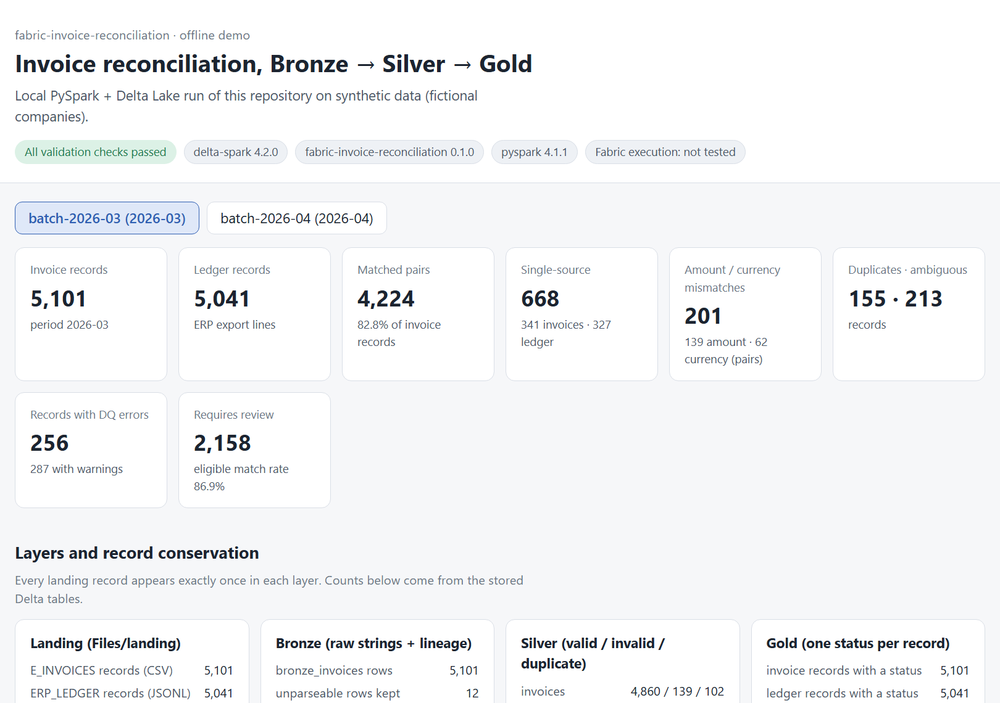
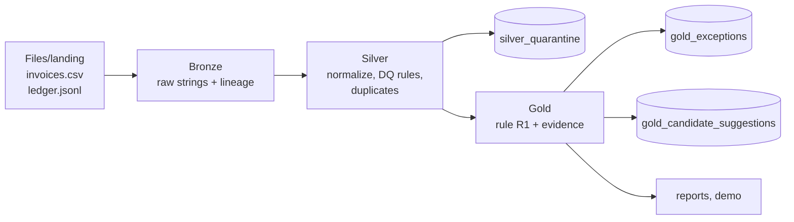
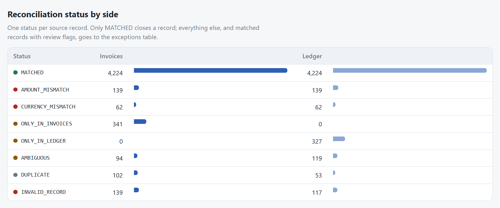

# Fabric Invoice Reconciliation

Invoice reconciliation on PySpark and real Delta Lake tables, organized as a Bronze / Silver / Gold
lakehouse: raw ingestion with lineage, data-quality rules with a quarantine table, one deterministic
matching rule with evidence for every decision, and idempotent per-batch writes.



**Stack:** PySpark 4.1.1 · Delta Lake 4.2.0 (`delta-spark`) · Python 3.11 / 3.13 · Java 17 / 21 · pytest ·
GitHub Actions. **Try it:** [Quick Start](#10-quick-start) or open `demo/index.html` offline.

> **Demo scope.** Verified locally and in CI on synthetic data. The layout follows a Microsoft Fabric
> Lakehouse and a notebook targets Fabric Runtime 2.0, but **execution inside Fabric is not tested**.

## 1. Project Overview

Two synthetic sources describe the same purchases: electronic invoices (CSV) and an ERP ledger export
(JSON Lines). The pipeline lands both as raw strings (Bronze), normalizes and quality-checks them (Silver),
and reconciles them with one deterministic rule (Gold). Every source record gets exactly one status,
every decision keeps its evidence, and everything that needs a person goes to an exceptions table.

## 2. Problem Statement

Accounts payable teams have to prove that every invoice received was recorded, and recorded correctly.
In practice references are typed in different formats, amounts differ by a cent, currencies are mixed
up, files contain duplicates and broken rows, and dates like `04/03/2026` can be read two ways. A
reconciliation that quietly drops bad rows, matches on NULLs, or lets one invoice match two postings
produces numbers nobody can defend. This project shows a reconciliation where each of those cases is
handled explicitly and can be audited.

## 3. Key Features

* Real PySpark transformations and real Delta Lake tables (no pandas in the processing path).
* Bronze keeps original values, line numbers, a hash of each raw line and unparseable rows.
* Silver: identifier canonicalization, whitespace cleaning, `try_*` conversions under ANSI mode,
  exact `DECIMAL(18,4)` amounts, dates validated without guessing, 23 data-quality rules (16 apply to
  invoices, 21 to the ledger), duplicate detection, a quarantine table with reasons and per-batch
  quality metrics.
* Gold: rule R1 (supplier + normalized reference + currency + tolerance), eight statuses, review flags,
  match evidence, an exceptions queue and batch metrics.
* Similarity suggestions (Levenshtein) for unmatched records: scored, explained, never auto-approved.
* Per-batch idempotency with `replaceWhere`; a MERGE-maintained control table.
* 23 record-conservation and invariant checks run against the stored tables, plus 2 that compare every
  synthetic record with the outcome it was designed to produce.
* CLI with documented exit codes, a Fabric notebook, an offline HTML demo built from a real run.

## 4. Architecture



Details: [docs/architecture.md](docs/architecture.md).

## 5. Technology Stack

| Area | Choice |
| --- | --- |
| Processing | PySpark 4.1.1 (Spark SQL functions, ANSI mode) |
| Storage | Delta Lake 4.2.0 (`delta-spark`), path-based tables under `Tables/` |
| Runtime | Python 3.11 and Java 17 locally; CI also runs a Spark/Delta smoke on Python 3.13 and Java 21 |
| Notebook | Jupyter format, written for a Fabric Spark notebook |
| Tests | pytest on a local Spark session |
| Demo | static HTML, CSS and JavaScript, no network access |

Version choices and their sources: [docs/fabric.md](docs/fabric.md).

## 6. Data Model

| Layer | Tables |
| --- | --- |
| Bronze | `bronze_invoices`, `bronze_ledger`, `bronze_ingestion_errors` |
| Silver | `silver_invoices`, `silver_ledger`, `silver_quarantine`, `silver_dq_metrics` |
| Gold | `gold_reconciliation`, `gold_match_evidence`, `gold_candidate_suggestions`, `gold_exceptions`, `gold_batch_metrics` |
| Control | `ops_batch_runs` |

Every batch table is partitioned by `_batch_id` and created from an explicit schema. Columns and grain:
[docs/data-model.md](docs/data-model.md).

## 7. Reconciliation Logic

Only valid records with a non-NULL key (`supplier_id | normalized reference`) take part. Keys are
counted per side and the two count tables are joined with a FULL OUTER JOIN, so each key is classified
exactly once: one-to-one, one side only, or several candidates. Records are joined back only for
one-to-one keys, so no record can be matched twice and NULLs can never pair up.

| Status | Meaning |
| --- | --- |
| `MATCHED` | same supplier, reference and currency; difference within the currency tolerance (0.01, or 1 for JPY) |
| `AMOUNT_MISMATCH` / `CURRENCY_MISMATCH` | one-to-one key, but the amount or the currency differs (no conversion) |
| `ONLY_IN_INVOICES` / `ONLY_IN_LEDGER` | no eligible counterpart (the reason says whether a quarantined one exists) |
| `AMBIGUOUS` | several records share the key (for example a possible double posting) |
| `DUPLICATE` / `INVALID_RECORD` | quarantined in Silver, with the rule that failed |

Details, flags and the evidence format: [docs/reconciliation-logic.md](docs/reconciliation-logic.md).

## 8. Data Quality

Malformed rows stay in Bronze, every Silver row gets `VALID`, `INVALID` or `DUPLICATE`, and every
non-valid row is quarantined with its reason. Posting dates such as `04/03/2026` keep both candidate
dates and go to review instead of being guessed. Rule catalog, normalization and checks:
[docs/data-quality.md](docs/data-quality.md).

## 9. Delta Lake

Data tables are overwritten per batch with `replaceWhere`; the control table is upserted with MERGE.
Writes are refused when the schema differs or rows belong to another batch, and row counts are read
back after each write. Verified versus not tested guarantees: [docs/delta-lake.md](docs/delta-lake.md).

## 10. Quick Start

Validated combinations: Python 3.11 + Java 17 (full suite, in CI on Ubuntu and locally on Windows 11),
Python 3.13 + Java 21 (real Spark/Delta smoke in CI on Ubuntu), and the tests without a JVM on Ubuntu
and Windows with Python 3.11 and 3.13. Other combinations have not been run. Spark needs a JDK in
`JAVA_HOME` and, on Windows, `winutils.exe` and `hadoop.dll` in `%HADOOP_HOME%\bin`
([docs/environment.md](docs/environment.md)). The first run downloads the Delta jars from Maven Central.

```bash
python -m venv .venv && source .venv/bin/activate      # Windows: .venv\Scripts\activate
python -m pip install -e ".[dev]"
python -m invoice_recon generate-data        # 2 batches x 5,000 base invoices, seed 4242
python -m invoice_recon run                  # ingest, normalize, reconcile, validate, report
python -m invoice_recon demo                 # demo/data.js from the stored tables
```

Individual stages: `ingest`, `normalize`, `reconcile`, `validate`, `report` (all accept `--batch`).

| Exit code | Meaning |
| --- | --- |
| 0 | success |
| 1 | unexpected internal error |
| 2 | usage error |
| 3 | input error: missing landing data, manifest or upstream table; source schema mismatch |
| 4 | validation failed: conservation, invariants, designed-outcome agreement or demo drift |
| 5 | environment error: Java or Hadoop helpers missing, Spark failed to start |

## 11. Demo Walkthrough

Open [demo/index.html](demo/index.html) in a browser (no server needed). It shows, per batch, the key
figures, the record counts layer by layer, the status of every record by side, evidence examples,
the data-quality rules that fired, similarity suggestions, the exceptions queue and the validation
checks. All of it comes from `demo/data.js`, written by `python -m invoice_recon demo` from the Delta
tables of the default run.

Default run on the development machine (seed 4242, `run` from scratch in 631 s):

| Batch | Invoice records | Ledger records | Matched pairs | Reconciliation rate | Records to review | Designed-outcome agreement |
| --- | --- | --- | --- | --- | --- | --- |
| batch-2026-03 | 5,101 | 5,041 | 4,224 | 82.81% | 2,158 | 10,142 / 10,142 |
| batch-2026-04 | 5,095 | 5,067 | 4,186 | 82.16% | 2,176 | 10,162 / 10,162 |

The rate is matched invoices over invoice records. About 30% of the base invoices are deliberately
assigned to one of the 30 problem scenarios, so the rate describes the synthetic scenario mix, not
real-world performance.
"Designed-outcome agreement" counts records whose status and review decision equal the outcome the
generator designed for them, whose reason matches when one was designed, and whose flags include every
designed flag. It measures agreement with synthetic, designed outcomes, not accuracy against real data
(the validation check is named `SYNTHETIC_GROUND_TRUTH`).



## 12. Testing

```bash
python -m pytest -v                    # everything, needs Java (and the Windows helpers on Windows)
python -m pytest -m "not spark" -v     # no JVM: generator, configuration, CLI pre-flight, notebook format
```

158 tests. Local result on 2026-11-24 (Windows 11, Python 3.11.9, Java 17): 158 passed, 0 skipped,
0 failed, in 47 minutes; most of that time is Delta commit overhead on this machine. They include the
invariants that matter most: two NULLs never match, duplicates never multiply matches, one record is
never matched twice, re-running a batch leaves the row content of all 12 batch tables unchanged (same
row count and the same SHA-256 over the sorted per-row hashes, for both batches), and every synthetic
record gets the outcome it was designed for. The re-run is a new Delta version with new data files, so
the physical files are not byte-identical. `ops_batch_runs` (one row per batch and stage, upserted with
MERGE) gets new timestamps and is not compared; the test checks that it still holds 6 rows, all
`SUCCEEDED`.

CI runs in three layers: tests without a JVM on Ubuntu and Windows (Python 3.11 and 3.13), the full
suite on Ubuntu with Python 3.11 + Java 17, and a real Spark/Delta smoke (Delta I/O, pipeline,
matching invariants, CLI and demo on one small batch) on Python 3.13 + Java 21. The default
10,000-invoice run with the demo drift check is a manual workflow (`full-volume.yml`).

Inventory and what each test proves: [docs/testing.md](docs/testing.md).

## 13. Microsoft Fabric Compatibility

The code targets Fabric Runtime 2.0 (Spark 4.1, Delta Lake 4.2, Java 21, Python 3.13 per the official
runtime page). Locally it runs on PySpark 4.1.1 with delta-spark 4.2.0, Java 17 and Python 3.11. The
notebook [notebooks/fabric_invoice_reconciliation.ipynb](notebooks/fabric_invoice_reconciliation.ipynb)
imports the same package and documents the setup in a fictional workspace. Its code cells are executed
locally by the tests; **execution inside Fabric is not tested.** Differences and unverified points:
[docs/fabric.md](docs/fabric.md).

## 14. Implementation Status

| Capability | Status |
| --- | --- |
| Synthetic sources with 32 designed scenarios and their expected outcomes | Implemented |
| Bronze / Silver / Gold on local Spark with real Delta tables | Implemented |
| Rule R1, statuses, flags, evidence, exceptions, metrics | Implemented |
| Similarity suggestions (never applied) | Implemented |
| Per-batch idempotency, schema checks, count checks, MERGE control table | Implemented |
| CLI, reports, offline demo from real results | Implemented |
| Fabric Lakehouse paths and notebook setup | Simulated (local folder with the same layout) |
| Execution in a Fabric capacity, OneLake storage, SQL analytics endpoint | Not Tested |
| Concurrent writers, crash during a commit | Not Tested |
| Currency conversion, cross-batch carry-forward, partial payments | Planned |
| CI on GitHub Actions: fast tests, full Spark/Delta suite, Spark/Delta smoke on Python 3.13 + Java 21, manual full-volume run | Implemented; results in the repository's Actions tab |

## 15. Limitations

* All data is synthetic and generated by this repository; the scenario mix is designed, not observed.
* Matching is per batch. An invoice in March and its posting in April are not paired across batches.
* One rule only: one invoice to one posting. Partial payments, split postings and credit notes are not
  modelled.
* Amounts in different currencies are never compared; there is no exchange-rate table.
* Supplier IDs must follow the synthetic `SUP-####` contract; other identifier schemes need new rules.
* Similarity uses Levenshtein on ASCII-normalized names; accents and transliteration are not handled.
* Each table write is its own Delta commit; a stage that fails half-way is visible (`ops_batch_runs`,
  `validate`) and is repaired by re-running it, not rolled back.
* Local runs on Windows are slow (about 5 s per Delta commit on the development machine).

## 16. Roadmap

* Exchange-rate table with source and date, so cross-currency pairs can be compared with evidence.
* Carry-forward of unmatched records to the next batch, with ageing.
* One-to-many rules for split postings and partial payments.
* Run the notebook in a Fabric capacity and record the results.
* Data-quality thresholds that stop a batch when failure rates exceed a limit.

## 17. AI-Assisted Development Disclosure

I designed and directed this project; it was implemented with substantial help from Claude Code (Anthropic). I
defined the problem, scope, constraints and acceptance criteria, reviewed the design and the results, and decided
what to publish. Most of the code, tests and documentation were generated with the assistant under that direction,
which is why the commits carry a `Co-Authored-By` trailer. Results quoted here come from the automated tests,
evaluations and CI runs in this repository, on synthetic data. They show that the code behaves as described under
those conditions, not that it is ready for production, and nothing this README marks as simulated, planned or not
tested has been validated.
