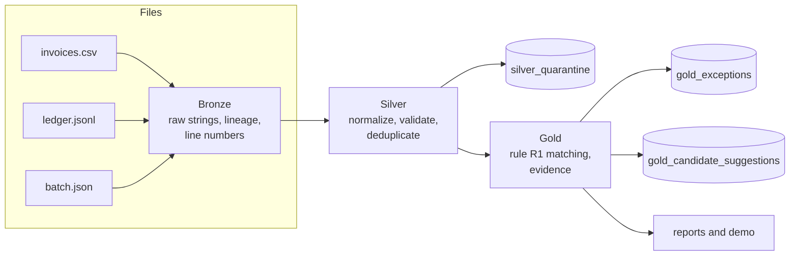

# Architecture

## Layout

The local lakehouse mirrors a Microsoft Fabric Lakehouse: files under `Files/`, Delta tables under `Tables/`.

```text
lakehouse/
  Files/
    landing/<batch_id>/batch.json        batch manifest (id, reconciliation period, source files)
    landing/<batch_id>/invoices.csv      source A: electronic invoices
    landing/<batch_id>/ledger.jsonl      source B: ERP ledger export
    synthetic_ground_truth/<batch_id>/   designed outcome of every synthetic record (tests only)
    reports/<batch_id>/                  reconciliation_report.json and .md
  Tables/
    bronze_invoices  bronze_ledger  bronze_ingestion_errors
    silver_invoices  silver_ledger  silver_quarantine  silver_dq_metrics
    gold_reconciliation  gold_match_evidence  gold_candidate_suggestions  gold_exceptions  gold_batch_metrics
    ops_batch_runs
```

## Flow



| Module | Responsibility |
| --- | --- |
| `generator.py` | Deterministic synthetic sources and their designed outcomes (plain Python; it fabricates input files, it is not part of the Spark processing). |
| `bronze.py` | Reads each file whole, splits it into physical lines with `posexplode`, parses with `from_csv` / `from_json` in PERMISSIVE mode, checks the header (CSV) or first record (JSON) against the contract. |
| `silver.py`, `dq.py` | Text cleaning, identifier canonicalization, `try_*` conversions under ANSI mode, date parsing without guessing, DQ rules, duplicate detection, quarantine, per-rule metrics. |
| `reconcile.py` | Key classification with a FULL OUTER JOIN of per-side key counts, rule R1, evidence, similarity suggestions, exceptions, batch metrics. |
| `delta_io.py` | Table creation from explicit schemas, `replaceWhere` batch overwrites with read-back counts, MERGE into `ops_batch_runs`. |
| `pipeline.py` | Stage orchestration shared by the CLI and the notebook. |
| `validate.py` | Record conservation and invariant checks on the stored tables, plus the synthetic ground-truth comparison. |
| `report.py`, `demo.py` | JSON/Markdown reports and `demo/data.js`, both built from the stored tables. |
| `spark.py` | Local session (Delta extensions, Windows prerequisites) or reuse of an existing session. |
| `cli.py` | `generate-data`, `ingest`, `normalize`, `reconcile`, `validate`, `report`, `demo`, `run`. |

## Processing model

* **Batch = one reconciliation period.** A batch has one invoices file, one ledger file and a manifest.
  Matching happens inside a batch; nothing is carried across batches (see Limitations in the README).
* **Every stage is a pure function of its upstream batch slice.** Each stage overwrites its own slice
  (`replaceWhere _batch_id = '<id>'`), so re-running a stage or the whole batch converges to the same tables.
* **Nothing is filtered silently.** Bronze keeps unparseable lines, Silver keeps every row with a status,
  Gold gives every record exactly one status. `validate` checks this layer by layer.
* **Spark does the processing.** Only small aggregates and example rows are collected to the driver
  (metrics, reports). pandas is not used.

## Session handling

`spark.get_or_create_spark()` reuses an active session when there is one (a Fabric notebook, the test
suite). Otherwise it creates a local session with the Delta extensions and the settings listed in
[environment.md](environment.md). `configure_session()` sets the two settings the pipeline relies on,
ANSI mode and a UTC session time zone, on any session.
